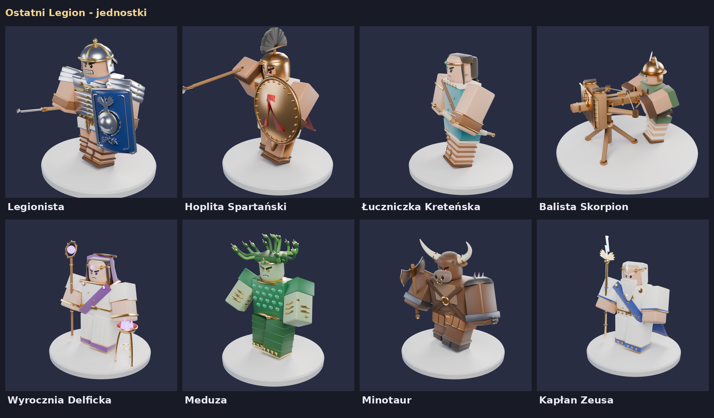

# Ostatni Legion: modele jednostek i animacje

Osiem jednostek do tower defense w stylu Gladiatora: klasyczny awatar R6, akcesoria z detalami,
wspólna biblioteka materiałów PBR i wściekła twarz w stylu Robloxa. Każda jednostka ma
**postój (pętla)** i **3 ataki** przypięte do poziomów ulepszeń (poz. 0–1, 2–3, 4–5).
Ataki ruszają całym ciałem (tułów, nogi, wykrok, wyskok), a bronie mają smugę „Swoosh”.



| Jednostka | Typ | Wygląd (własna paleta, żeby nie mylić z Gladiatorem) | Ataki |
|---|---|---|---|
| Legionista | Militarna | lorica segmentata, stalowa galea z krzyżowymi okuciami, płócienna tunika, **granatowe scutum ze srebrnym orłem i SPQR**, pilum | pchnięcie pilum · rzut pilum · tarcza + pchnięcie |
| Hoplita Spartański | Militarna | hełm koryncki z czarnym grzebieniem, brązowy pancerz mięśniowy, aspis z lambdą, karmazynowy płaszcz, dory | pchnięcie dory · odepchnięcie tarczą · falanga (3 pchnięcia) |
| Łuczniczka Kreteńska | Militarna | turkusowy chiton, złota opaska, czarny warkocz, kołczan, refleksyjny łuk z cięciwą | strzał · potrójna salwa · deszcz strzał |
| Balista Skorpion | Militarna | scorpio na trójnogu (sprężyny z liny, złoty skorpion na tarczy) + inżynier w hełmie Montefortino | strzał bełtem · bełt przebijający · salwa 3 bełtów |
| Wyrocznia Delficka | Magiczna | biała suknia, fioletowy welon i himation, wieniec laurowy, laska z kulą, trójnóg z fioletowym ogniem | wizja (puls wykrywania) · proroctwo (promień) · opary Delf (obszar) |
| Meduza | Magiczna | zielona skóra, wężowe oczy, włosy z żywych węży, szmaragdowa łuskowa suknia, złote węże | kamienne spojrzenie · ukąszenie węży · klątwa Gorgony |
| Minotaur | Magiczna | większe ciało, głowa byka z rogami i kółkiem w nosie, kopyta, kajdany z łańcuchem, labrys | cios labrysem · wir · szarża na rogach |
| Kapłan Zeusa | Legendarna | siwa broda, złoty wieniec z piorunem, biel + królewski błękit, berło ze skrzydłami i piorunem | piorun z nieba · łańcuch piorunów · gniew Zeusa |

Plansze z klatkami każdej animacji: `renders/<Jednostka>_animacje.png`, główny render: `renders/<Jednostka>_hero.png`.
Zgodnie z Quality Bar nie ma filmików, są same klatki.

## Pliki

```
ostatni-legion/
  blender/               skrypty (Blender 4.x/5.x, tryb tła albo moduł bpy)
    build_all.py         buduje wszystko: model -> GLB -> animacje -> dane -> .blend -> rendery
    lib/                 wspólne: materials.py (PBR), face.py (twarz), rig.py (R6 + jointy),
                         anim.py (pozy -> klatki), kit.py (akcesoria), export.py, render.py
    units/<jednostka>.py model + animacje jednej jednostki
  export/<Jednostka>/
    <Jednostka>.glb          model w pozie spoczynkowej (części "<Joint>__<materiał>")
    <Jednostka>_UnitData.lua dane klatek (ModuleScript do ReplicatedStorage.OstatniLegion.UnitData)
    <Jednostka>.json         te same dane w JSON
    <Jednostka>_face.png     tekstura twarzy
    <Jednostka>.blend        scena z rigiem, animacjami i markerami zdarzeń
  roblox/
    RigBuilder.lua           składa GLB w rig na Motor6D według UnitData
    UnitAnimator.lua         odtwarza klipy po stronie klienta (Transform, blend, zdarzenia, Swoosh)
  renders/                   plansze klatek + hero
```

Przebudowa jednej jednostki: `blender -b -P blender/build_all.py -- meduza`
(albo `python blender/build_all.py meduza` z modułem `bpy`). Opcje: `--no-render`, `--quick`.

## Do Roblox Studio

1. Zaimportuj `export/<Jednostka>/<Jednostka>.glb` (3D Importer). Model jest już obrócony
   przodem w -Z (LookVector).
2. Wrzuć `<Jednostka>_UnitData.lua` jako ModuleScript `ReplicatedStorage.OstatniLegion.UnitData.<Jednostka>`.
3. W pasku poleceń:
   ```lua
   local RB = require(game.ReplicatedStorage.OstatniLegion.RigBuilder)
   RB.Build(workspace.Legionista, require(game.ReplicatedStorage.OstatniLegion.UnitData.Legionista))
   workspace.Legionista:ScaleTo(0.55)
   ```
   Builder sam dopasowuje skalę i położenie importu (porównuje bounding box z danymi), robi
   kotwice jointów, Motor6D i Attachmenty efektów (np. `PilumTip`, `BowGrip`, `StaffTop`, `Eyes`).
4. Na kliencie:
   ```lua
   local anim = UnitAnimator.new(model, require(UnitData.Legionista))
   anim:On("Hit", function(ev) --[[ VFX / dźwięk; ev.Projectile, ev.Area, ev.Stun... ]] end)
   -- na sygnał UnitAttack z serwera:
   anim:PlayAttack(UnitAnimator.AttackForLevel(level))
   ```

**Format danych:** 30 fps, osie Robloxa. Na każdą klatkę i joint jest 7 liczb `px, py, pz, qx, qy, qz, qw`
= `Motor6D.Transform` (C0 = przesunięcie od rodzica, C1 = 0, poza spoczynkowa to stojąca postać).
Przesunięcia są w studach przy skali 1. `UnitAnimator` mnoży je przez `RigScale × Model:GetScale()`.
Jeśli wolisz zostać przy obecnym `StarterPlayerScripts.UnitAnimator` (garda w C0), to
`Transform = garda⁻¹ × poza`. Pozy z tych danych liczy się wtedy względem klatki 0 klipu Idle.

**Zdarzenia w klipach:** `Hit` (trafienie albo wystrzał; pola `Projectile`, `Speed`, `Attachment`,
`Area`, `Stun`, `Knockback`, `Pierce`, `Chain`...), `Shoot`, `TrailOn`/`TrailOff` (smuga między
Attachmentami `A` i `B`), `Hide`/`Show` (np. wyrzucone pilum, strzała na cięciwie, bełt w baliście).

## Klipy i klatki trafień
